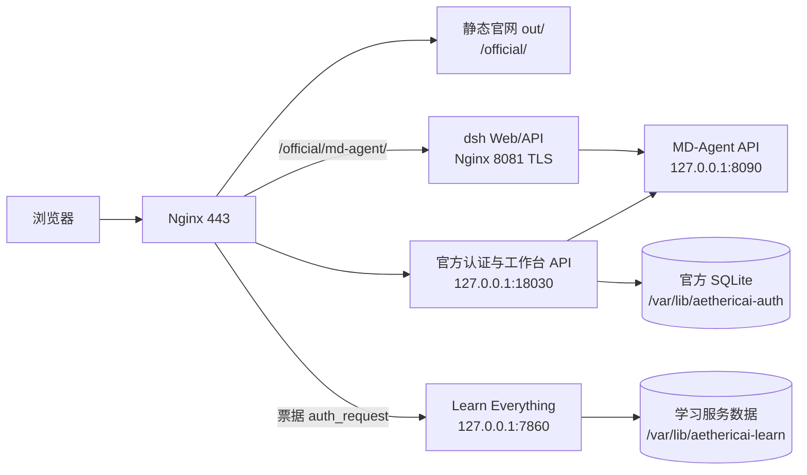

# 以太智元官网与项目文件对接总文档

> 文档用途：给官网、认证服务、已接入产品和后续产品负责人使用。本文说明“哪个项目负责什么、文件从哪里进入官网、接口如何衔接、部署后如何验证”。它记录当前可验证的集成边界，不把候选项目或占位页面写成已上线产品。

最后核对：2026-10-08。详细版本和验收证据见同目录的 `PROJECT_VERSIONS.md`、`PROJECT_ACCEPTANCE.md` 及各专题文档。

## 1. 官网的定位和生产入口

AetherMind-Official-Site 是以太智元总官网的主仓库。官网负责品牌展示、产品目录、统一登录、账户工作台、产品权益和各产品入口；具体产品的计算、模型调用、资料处理和业务数据仍由各产品服务负责。

| 项目项 | 当前值 |
|---|---|
| 源码根目录 | `/Users/joseph/Repository/Angsheng/AetherMind-Official-Site` |
| 官网主入口 | `https://8.130.144.193/official/` |
| 临时托管域名 | `https://angsheng.luluyun.xyz/`，域名指向和 TLS 以生产 Nginx 为准 |
| 前端技术 | Next.js 16 + React 19 + TypeScript + Tailwind/原生 CSS |
| 构建方式 | `NEXT_PUBLIC_BASE_PATH=/official bun run build`，输出静态 `out/` |
| 生产前端 | Nginx 直接读取 `/opt/aethericai-official/current/out/` |
| 官网 API 前缀 | 浏览器使用 `/official-api/`，Nginx 转发到 `127.0.0.1:18030` |
| 独立认证服务 | `aethericai-auth.service`，模块入口 `python -m official_api` |
| 公网 TLS | Nginx 443；证书和私钥不进入 Git |
| 旧小程序 API | `/llmer-api/` 仍是独立边界，不因官网改动而替换 |

官网是静态导出站点，因此不能把 Next.js server action、Node 常驻进程或服务器端页面状态当成生产能力。需要登录、权益、积分、用量或产品跳转时，必须接入 `/official-api/` 或受保护的产品服务。

## 2. 总体架构和请求路径



访问边界：

1. `/official/` 是静态页面和构建资源。
2. `/official-api/` 是官网自己的认证、账户和产品管理 API。除公开产品目录外，接口都依赖官网 Bearer access token。
3. `/official/md-agent/` 是同域 dsh 入口。官网后端先校验产品资格，再通过 MD-Agent BFF 绑定个人账号和短票。
4. `/official/learn-everything/` 是激活门禁后的 Gradio 服务。Nginx 对入口 HTML、静态资源和队列/WebSocket 请求统一执行短票检查，7860 只监听本机。
5. `123.57.30.164`、`llmer-api` 和小程序现有服务属于旧业务边界。除明确的兼容接口外，不把官网新逻辑直接写入旧服务。

## 3. 官网文件地图

### 3.1 页面路由

| URL | 页面文件 | 作用 |
|---|---|---|
| `/official/` | `src/app/page.tsx` | 官网首页，品牌、科学计算叙事、控制台入口 |
| `/official/products/` | `src/app/products/page.tsx` | 产品目录和产品详情弹层 |
| `/official/products/learn-everything/` | `src/app/products/learn-everything/page.tsx` + `src/components/LearnEverythingPage.tsx` | Learn Everything 详情、操作手册、登录/激活/进入工作台 |
| `/official/console/` | `src/app/console/page.tsx` + `ConsolePage.tsx` | MD-Agent 科学控制台，显示智能体目录和待接入状态 |
| `/official/dashboard/` | `src/app/dashboard/page.tsx` + `DashboardPage.tsx` | 登录后的账户工作台、用量、权益、积分、管理中心 |
| `/official/profile/` | `src/app/profile/page.tsx` + `ProfilePage.tsx` | 个人中心、账号信息和密码设置入口 |
| `/official/login/` | `src/app/login/page.tsx` + `LoginPage.tsx` | 手机验证码登录、手机号密码登录、选填产品邀请码 |
| `/official/community/` | `src/app/community/page.tsx` + `CommunityPage.tsx` | 社区页面，复用官网认证和原社区数据契约 |
| `/official/legal/` | `src/app/legal/page.tsx` + `LegalPage.tsx` | 服务条款、隐私和第三方服务说明 |

### 3.2 共用前端基础

| 文件 | 责任 |
|---|---|
| `src/components/Nav.tsx` | 官网顶栏、语言切换、登录弹层和控制台入口 |
| `src/components/LanguageProvider.tsx` | 中英文状态和本地偏好 |
| `src/lib/asset-url.ts` | 给所有站内链接和资源添加 `/official` base path |
| `src/lib/account-client.ts` | Bearer token、refresh、登出、账户 API 类型 |
| `src/lib/community-login.ts` | 登录返回路径 allowlist，禁止外部开放重定向 |
| `src/lib/site.ts` | 品牌、主导航、辅助导航和产品入口配置 |
| `src/data/productAssets.ts` | 产品图片和官网素材映射 |
| `src/app/globals.css` | 全站字体、颜色、基础布局和动效 |
| `src/components/*.css` | 登录、产品、控制台、仪表盘和个人中心局部样式 |

### 3.3 视觉和科学场景

`src/components/sections/` 保存首页的科学叙事区块：`AIScience`、`ComputationalEngine`、`MolecularDynamics`、`Infrastructure`、`PlatformDefinition`、`Results`、`Scenarios`、`Workflow`、`FinalCTA` 和 `Footer`。`src/components/primitives/` 保存粒子场、分子场、滚动揭示、实时数字和图片等基础组件；`src/lib/*renderer*`、`science-worker*`、`molecular-*` 负责浏览器端科学视觉，不和账户后台共享业务数据。

如果只是接入产品，不应改动科学场景和登录材质；产品内容应进入 `ProductsPage`、独立详情页或控制台页面。

## 4. 登录、账户和工作台对接

### 4.1 浏览器会话

`src/lib/account-client.ts` 使用浏览器 `localStorage` 保存三项官网会话信息：

- `aethericai-community-access-token`
- `aethericai-community-refresh-token`
- `aethericai-community-access-expires`

调用私有 API 时发送 `Authorization: Bearer <accessToken>`。收到 401 且存在 refresh token 时调用 `/official-api/api/v1/auth/refresh`，成功后重试一次；刷新失败会清理本地会话。

前端不得把密钥、产品服务凭据、MD-Agent Token 或模型 Key 放入 localStorage、URL、静态构建环境变量或日志。

### 4.2 登录入口

`LoginPage.tsx` 支持：

- 手机号 + 短信验证码登录，未注册手机号在短信验证成功后创建官网账号。
- 手机号 + 密码登录；首次设置密码和改密都要求已绑定手机号再次短信验证。
- 登录时可填产品邀请码。邀请码只授予它声明的产品资格，不授予管理员、积分或其他产品。
- `returnTo` 经过 `communityReturnPath()` allowlist，只允许官网社区、产品、控制台、仪表盘和产品详情路径。

新增产品入口应使用：

```ts
const returnTo = encodeURIComponent(assetUrl("/products/<product-id>/"));
window.location.assign(`${assetUrl("/login/")}?returnTo=${returnTo}`);
```

不要直接拼接用户提供的外部 URL。

### 4.3 账户 API

生产浏览器前缀是 `/official-api/api/v1/console`，后端实现位于 `server/official_api/`，底层认证、SQLite、短信和社区复用 `server/llmer_api/`。

| API | 用途 | 权限 |
|---|---|---|
| `GET /me` | 当前用户、角色、尾号、余额 | 登录 |
| `GET /dashboard` | 用量、趋势、权益、流水、订单和产品 | 登录 |
| `GET /products` | 产品目录和套餐 | 公共读取 |
| `POST /redeem` | 兑换产品邀请码/积分码 | 登录 |
| `POST /purchases` | 用积分购买已上架产品 | 登录、权益和余额校验 |
| `/admin/*` | 用户、角色、积分、批次、产品、凭据和审计 | ADMIN/OWNER 按范围 |
| `GET/POST /md-agent/*` | MD-Agent 资格、绑定、进入 | 登录 + 对应资格 |
| `POST /learn-everything/entry` | 签发学习工作台短票 | 登录 + `learn-everything` 有效权益 |

官方 SQLite 生产路径是 `/var/lib/aethericai-auth/auth.sqlite3`。常见表包括 `official_products`、`official_entitlements`、`official_wallets`、`official_ledger`、`official_codes`、`official_batches`、`official_usage`、`official_roles`、`official_audit`、`official_md_agent_qualifications` 和 `official_md_agent_bindings`。

总管理员能做的业务操作通过 `AdminPanel.tsx` 调用，后端仍是最终权限边界；不要只在前端隐藏按钮就认为完成权限控制。

## 5. 产品接入契约

### 5.1 产品目录

当前目录的后端种子在 `server/official_api/workspace.py` 的 `CATALOG`，前端展示在 `src/components/ProductsPage.tsx`。两边的 `productId` 必须完全一致。

当前核心 ID：

| ID | 产品 | 状态/入口 |
|---|---|---|
| `platform` | 以太智元平台 | 官网工作台/样板 |
| `lammps` | LAMMPS 计算引擎 | 产品目录 |
| `md-exp` | MD EXP | `/official/console/`，资格后进入 dsh |
| `agent` | 科学智能体 | 产品目录 |
| `materials` | 材料计算 | 待配置 |
| `chemistry` | 化学与分子计算 | 待配置 |
| `biology` | 生物计算 | 待配置 |
| `learn-everything` | Learn Everything 学习 Agent | `/official/products/learn-everything/`，邀请码激活后进入学习服务 |

目录里的 `COMING_SOON` 只是购买状态；邀请码资格可以独立授予产品。正式上线购买前由 OWNER 在管理中心配置价格、次数、有效天数、单位积分成本和入口。

### 5.2 新产品接入步骤

1. 给产品确定稳定的 `productId`，写入后端 `CATALOG` 和前端产品数据。
2. 把产品图片放入 `public/assets/products/` 或更新 `src/data/productAssets.ts`，不要引用开发机绝对路径。
3. 确定详情页或控制台入口。需要登录时使用官网登录返回路径；需要资格时调用 `/redeem`/权益查询，不在浏览器写死管理员手机号。
4. 给产品服务端发放产品专属 integration key。凭据只保存在产品服务端；官网只保存哈希、尾号和撤销状态。
5. 产品执行真实调用前，使用产品 key 调用 `POST /api/v1/console/integrations/usage`，记录真实用户 ID、唯一 `eventId`、units 和 token 统计。
6. 先在本地隔离 SQLite 测试权限、幂等、并发、余额/次数不足和跨用户隔离，再配置产品套餐。
7. 生产接入必须提供健康检查、失败补偿策略和入口 200/401/403/404 验收，不能只提交一个链接。

### 5.3 用量记录

请求字段：`eventId`、`userId`、`units`、`inputTokens`、`cachedTokens`、`outputTokens`。`cachedTokens` 不能超过输入；积分成本由官网服务端按产品配置计算，客户端不能自报积分。

用量事件使用产品专属 Bearer key，普通官网会话不能上报。相同产品的同一 `eventId` 必须可安全重试；事件和权益扣减在一个事务中完成。真实业务失败后的退款/补偿由产品方和 OWNER 约定，目前没有客户端退款接口。

## 6. MD-Agent / dsh 对接

官网控制台在 `src/components/ConsolePage.tsx`；后端 BFF 在 `server/official_api/md_agent.py`。

流程：

1. 用户访问 `/official/console/`，未登录可浏览卡片。
2. 点击 MD EXP 时，如果未登录跳官网登录；没有 `md-exp` 资格则提示使用对应邀请码。
3. `POST /api/v1/console/md-agent/bind` 使用服务端专用 BFF 管理凭据，在 MD-Agent 创建/审批个人账号，并把个人 Token 加密保存到 `official_md_agent_bindings`。
4. `POST /api/v1/console/md-agent/enter` 用个人 Token 向 MD-Agent 申请短票，再把入口改写为 `/official/md-agent/open?ticket=...`。
5. Nginx 将同域 dsh 页面、根级 `/assets/`、`/api/`、`/plugins/` 和 8081 WebSocket/SSE 转发到 MD-Agent。

模型 provider 和 key 只存在服务器受保护配置。官网前端只展示模型状态和模型 ID，不展示密钥。

## 7. Learn Everything 对接

### 7.1 源项目关系

| 项目 | 作用 |
|---|---|
| `learn-everything-main` | 原始/主线学习 Agent 参考，缺少当前 Mac 运行环境，不直接作为服务器包 |
| `learn-everything-mac` | 当前服务器移植依据；`learning_ext/` 是学习功能，`kotaemon/` 是 RAG 底座，`custom_app.py` 是 Gradio 入口 |
| 官网 `LearnEverythingPage.tsx` | 产品详情、操作说明和官网登录/激活/进入门禁 |
| `server/official_api/learn_everything.py` | 学习产品权益检查和短票签发/校验 |
| `deploy/wulanchabu/locations.conf` | Nginx `auth_request` 和 Gradio 反向代理 |

详情页操作手册依据 Mac 版 `learning_ext/guide.py`，包含模型配置、路线、资料库、问答、工作台、FSRS、测验、看板、导出和常见问题。

### 7.2 入口门禁

- 未登录：详情页按钮跳 `/official/login/`，`returnTo` 保留产品详情页。
- 已登录但无有效权益：打开产品邀请码激活框，调用 `/redeem` 后重新读取 dashboard 权益。
- 已激活：调用 `POST /api/v1/console/learn-everything/entry` 获得 5 分钟短票，跳到 `/official/learn-everything/?ticket=...`。
- Nginx 入口、资源和队列请求由内部授权子请求校验短票/Cookie；没有票据直接 403。

当前服务器服务是单实例 Mac 架构，学习资料、路线、复习和看板数据还没有按官网 user ID 隔离。完成多租户改造前，不能把该服务描述为多用户生产工作台。

## 8. 兄弟项目与接入状态

这些目录位于 `/Users/joseph/Repository/Angsheng/`，不是官网仓库的子目录。默认只把它们当作产品源项目或参考项目，不会因为存在目录就自动上线。

| 项目目录 | 项目角色 | 当前官网关系 |
|---|---|---|
| `autolammps-main` | AutoMD/LAMMPS CLI、agent、skill、知识库和插件市场 | 可作为 LAMMPS/AutoMD 产品源；需要另建服务端入口、用户映射和用量上报 |
| `automd-npm-package` | `@luluyun/automd` 的 npm 分发包 | CLI 分发项目，不是官网页面；产品接入应链接产品说明或服务端 API |
| `learn-everything-main` | Learn Everything 主线参考 | 只做功能/结构参考 |
| `learn-everything-mac` | Learn Everything Mac 版 | 已作为服务器 Gradio 预览依据，见上一节 |
| `resume-campaign-agent` | 简历海投辅助器，含 FastAPI、浏览器插件和自己的工作台 | 当前独立项目；若接官网，复用官网账号与产品权益，不复制一套登录 |
| `mini-sof/LLMer` | 参数人类微信小游戏及其 API/支付/题库服务 | 旧业务独立部署；官网只通过明确的产品或社区合同接入 |
| `final-offical-site` | 旧/候选官网源码和历史产物 | 参考或归档，不作为当前生产源 |
| `ai-lesson` | 课程/研究内容项目 | 尚未形成官网产品接口，需先定义产品 ID、入口和服务契约 |
| `silver-ages` | 独立 Android/服务项目 | 尚未接入官网 |

每个新项目都必须先回答：产品 ID、详情页文案、登录返回路径、是否需要邀请码、服务端入口、用户 ID 如何传递、用量如何计费、数据保存在哪里、失败如何补偿、谁负责发布和回滚。

## 9. 服务器目录、服务和端口

| 资源 | 用途 |
|---|---|
| `/opt/aethericai-official/releases/<version>/out` | 官网静态发布包 |
| `/opt/aethericai-official/current` | 当前官网静态版本软链接 |
| `/srv/aethericai-auth/releases/<version>` | 官方认证服务代码和虚拟环境 |
| `/srv/aethericai-auth/current` | 当前认证服务版本软链接 |
| `/var/lib/aethericai-auth/auth.sqlite3` | 官网账户、权益、积分、审计数据库 |
| `/var/lib/aethericai-learn/` | Learn Everything 数据、缓存、配置和 theflow 状态 |
| `/opt/mdagent/` | MD-Agent 代码、账号、账本、前端预览和插件 |
| `/etc/nginx/snippets/aethericai-official-locations.conf` | 官网专用 Nginx 路由 |
| `/etc/systemd/system/aethericai-auth.service` | 官网认证后台 |
| `/etc/systemd/system/aethericai-learn.service` | Learn Everything Gradio 服务 |

生产监听关系：443 为 Nginx；18030 为官网认证 API；8090 为 MD-Agent API；8081 为 dsh 内部 TLS 入口；7860 为 Learn Everything 本机服务。修改端口前先查 Nginx、systemd 和现有服务的监听关系。

## 10. 发布、验收和回滚

### 10.1 官网静态发布

```bash
bun install
bun run lint
bun run build:ip
```

将 `out/` 放入新的 `/opt/aethericai-official/releases/<version>/`，先核对文件和 `index.html`，再原子替换 `current` 软链接。生产验证：

```bash
curl --fail https://8.130.144.193/healthz
curl --fail https://8.130.144.193/official/
curl --fail https://8.130.144.193/official/products/
nginx -t
```

### 10.2 认证后台发布

先复制 `/var/lib/aethericai-auth/auth.sqlite3`，创建新后端 release，再切换 `/srv/aethericai-auth/current`。重启只针对 `aethericai-auth`，确认 `/readyz`、产品目录和匿名私有接口状态；不要用旧数据库文件覆盖新表和新审计记录。

### 10.3 Nginx 和产品服务

Nginx 配置改动前复制配置快照并运行 `nginx -t`，通过后使用 `systemctl reload nginx`。Learn Everything 需要同时确认 `systemctl status aethericai-learn`、`127.0.0.1:7860` 和无票据 403；不要把 7860 改为公网监听。

回滚原则：代码、静态包和 Nginx 可以回滚到旧版本；数据库采用向前兼容和备份恢复策略，不能直接用旧 SQLite 覆盖已经产生的新账户、权益、积分或审计记录。

## 11. 本地验证清单

| 范围 | 命令/检查 |
|---|---|
| 前端静态导出 | `bun run lint`、`bun run build:ip` |
| 官网账户后台 | `server/.venv/bin/python -m pytest server/tests -q` |
| Learn Everything Mac 功能 | `kotaemon/.venv/bin/python -m pytest tests -q` |
| 学习服务 | 本机启动后访问 7860，检查模型配置、路线、资料库、复习、测验、看板 |
| 生产静态页面 | 官网首页、产品页、详情页、登录页和控制台路径 HTTP 200 |
| 认证门禁 | 未带 token 的 dashboard/admin 返回 401；未带学习票据的工作台及资源返回 403 |
| 权益事务 | 生成测试产品码、兑换、进入、重放和过期检查必须使用隔离 SQLite |
| 项目治理 | `init_project_management.py --validate` 和 `--audit` |

不要把 `server/tests/preview.py`、Mac 真实模型测试、测试短信、生产数据库、API Key、SSH 私钥或 Nginx 证书复制进发布包。

## 12. 新产品交接模板

新增产品时在此文档或独立专题文档中补齐：

1. 产品名称、`productId`、中英文描述、图片和详情页。
2. 源项目路径、运行时、启动命令、数据目录和健康检查。
3. 官网登录/激活/购买逻辑，以及是否需要定向邀请码。
4. 服务端用户 ID 映射、产品 key、调用计量、积分成本和幂等事件 ID。
5. 前端入口、Nginx 路径、内部端口、WebSocket/SSE 需求和 CSP/资源路径。
6. 测试命令、浏览器验收路径、生产发布目录、回滚版本和负责人。
7. 多用户数据隔离、隐私边界、错误重试、超时和业务失败补偿方案。

只有当这些字段和验收证据齐全，产品才能从“目录展示/样板”变为“已接入”。
